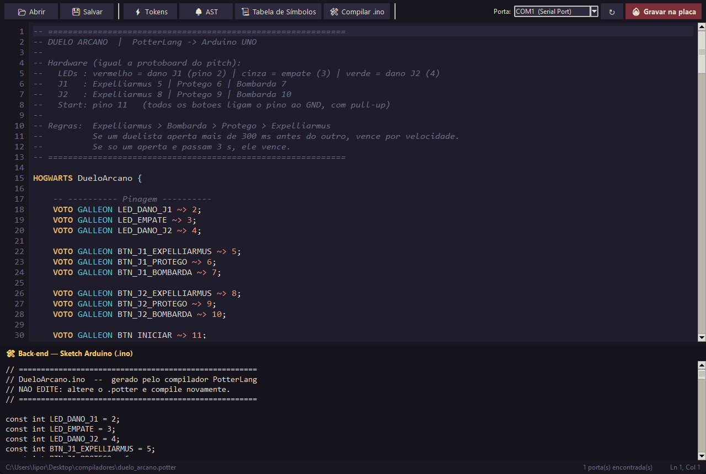
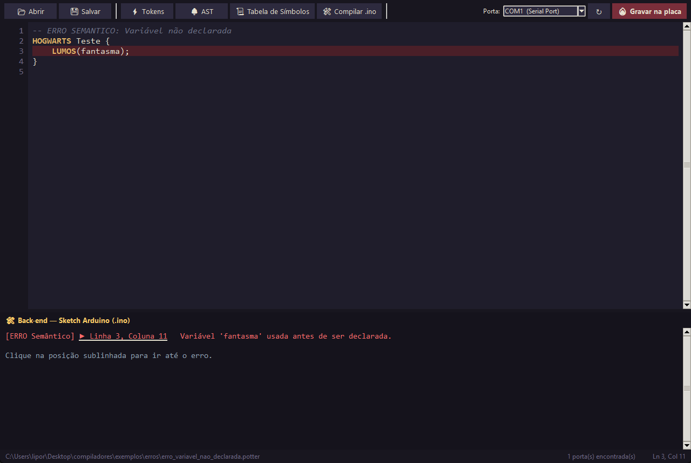

# PotterLang 🪄

**PotterLang** é uma linguagem de programação temática (universo de Harry Potter)
criada para a disciplina de **Linguagens Formais e Compiladores**. O compilador,
escrito em Python, faz análise léxica, sintática (LL(1)) e semântica com tabela de
símbolos, e gera um **sketch Arduino (C++)** que roda num Arduino UNO.

A demonstração prática é o jogo **Duelo Arcano** ([duelo_arcano.potter](duelo_arcano.potter)):
dois jogadores escolhem feitiços em botões e LEDs mostram quem venceu.

```
 .potter ──► Léxico ──► Sintático (AST) ──► Semântico (tabela de símbolos) ──► Back-end ──► .ino ──► arduino-cli ──► placa
            potter_lang.py                                                potter_arduino.py        compilar_e_gravar.py
```

> **TODO(equipe):** nomes dos 4 integrantes e do professor.



---

## 1. Instalação (Windows)

1. **Python 3** com Tkinter (o instalador oficial já traz). Testado com Python 3.13.14 no Windows 11.
   Não há dependências de `pip`: o projeto usa só a biblioteca padrão.
2. **arduino-cli** e o core do UNO. Só são necessários para compilar o C++ e gravar na placa:
   ```powershell
   winget install ArduinoSA.CLI
   arduino-cli core update-index
   arduino-cli core install arduino:avr
   ```
   Feche e reabra o terminal depois do `winget` para atualizar o `PATH`.
3. *(Opcional)* **g++**, usado só pelos testes que simulam o jogo no PC:
   ```powershell
   winget install BrechtSanders.WinLibs.POSIX.UCRT
   ```
   Sem o g++, esses testes são pulados (`skipped`) e o resto funciona normalmente.

Clone e confira:

```powershell
git clone <url-do-repositorio> compiladores
cd compiladores
python -m unittest
```

## 2. Uso

### 2.1 Potter IDE (app)

```powershell
python potter_ide.py                       # abre com um exemplo
python potter_ide.py duelo_arcano.potter   # abre um arquivo
```

| Botão / atalho              | O que faz |
|-----------------------------|-----------|
| ⚡ Tokens (F6)              | análise léxica: tabela de tokens com linha:coluna |
| 🌳 AST (F7)                 | análise sintática: árvore de sintaxe abstrata |
| 📜 Tabela de Símbolos (F8)  | análise semântica: tabela de símbolos e assinaturas C++ inferidas |
| 🛠 Compilar .ino (F5)       | gera o sketch e grava em `<pasta do .potter>/<Programa>/<Programa>.ino` |
| Porta + ↻                   | lista as placas detectadas pelo `arduino-cli` |
| 🔥 Gravar na placa (F9)     | salva, compila com `arduino-cli` e grava na porta escolhida |
| Ctrl+N / Ctrl+O / Ctrl+S    | novo / abrir / salvar |

Os erros (léxicos, sintáticos, semânticos e de transpilação) aparecem com **linha e
coluna**. Ao clicar na posição sublinhada, o cursor vai até o erro. O menu
**Exemplos** abre o Duelo Arcano, os exemplos e uma pasta de programas com erro
(um por tipo de erro), útil para demonstrar o compilador.



### 2.2 Linha de comando

```powershell
# .potter -> .ino  (gera DueloArcano/DueloArcano.ino)
python potter_arduino.py duelo_arcano.potter
python potter_arduino.py duelo_arcano.potter --stdout      # só imprime

# .potter -> .ino -> arduino-cli compile -> upload
python compilar_e_gravar.py --listar-portas
python compilar_e_gravar.py duelo_arcano.potter --porta COM3
python compilar_e_gravar.py duelo_arcano.potter --so-compilar

# código intermediário de três endereços (TAC)
python potter_tac.py duelo_arcano.potter

# demonstração do front-end (tokens, AST, tabela de símbolos e erros)
python exemplo_potter.py
```

Saída real de `arduino-cli compile --fqbn arduino:avr:uno DueloArcano`:

```
Sketch uses 3726 bytes (11%) of program storage space. Maximum is 32256 bytes.
Global variables use 199 bytes (9%) of dynamic memory, leaving 1849 bytes for local variables. Maximum is 2048 bytes.
```

## 3. Exemplo

[exemplos/pisca_led.potter](exemplos/pisca_led.potter):

```
HOGWARTS PiscaLed {
    VOTO GALLEON INTERVALO_MS ~> 500;

    CAST pinMode(LED_EMBUTIDO, SAIDA);

    VIRATEMPO (ALWAYS) {
        CAST digitalWrite(LED_EMBUTIDO, ALTO);
        CAST delay(INTERVALO_MS);
        CAST digitalWrite(LED_EMBUTIDO, BAIXO);
        CAST delay(INTERVALO_MS);
    }
}
```

gera (`python potter_arduino.py --stdout exemplos/pisca_led.potter`):

```cpp
const int INTERVALO_MS = 500;

void setup() {
    pinMode(LED_BUILTIN, OUTPUT);
}

void loop() {
    digitalWrite(LED_BUILTIN, HIGH);
    delay(INTERVALO_MS);
    digitalWrite(LED_BUILTIN, LOW);
    delay(INTERVALO_MS);
}
```

## 4. Estrutura do repositório

```
potter_lang.py           front-end: Lexer, AST, Parser LL(1), Semântico + tabela de símbolos
potter_arduino.py        back-end: extensões, semântico Arduino e transpilador -> .ino
compilar_e_gravar.py     pipeline .potter -> .ino -> arduino-cli compile -> upload
potter_tac.py            código intermediário de três endereços (TAC) + interpretador
potter_api.py            funções puras usadas pela IDE (tokens, AST, tabela, .ino, diagnósticos)
potter_ide.py            Potter IDE (Tkinter)
exemplo_potter.py        demonstração do front-end no terminal
duelo_arcano.potter      o jogo (implementação prática)
DueloArcano/             sketch gerado (não editar à mão; é regenerado pelo compilador)
exemplos/                programas de exemplo; exemplos/erros/ = um programa por tipo de erro
dados/                   lista de macros do Arduino UNO (nomes que o back-end renomeia)
sim/                     mock do Arduino.h + simulador usados nos testes com g++
docs/                    documentação técnica (abaixo)
test_*.py                testes automatizados (unittest)
```

## 5. Documentação técnica

| Documento | Conteúdo |
|-----------|----------|
| [docs/frontend.md](docs/frontend.md) | explicação detalhada do front-end (`potter_lang.py`): Lexer, AST, Parser e Semântico |
| [docs/linguagem.md](docs/linguagem.md) | gramática EBNF, tokens, precedência, tipos, extensões do back-end |
| [docs/semantica.md](docs/semantica.md) | regras semânticas, escopos e a tabela de símbolos real do Duelo Arcano |
| [docs/backend.md](docs/backend.md) | tradução PotterLang → C++, inferência de tipos, `setup()`/`loop()`, limitações |
| [docs/tac.md](docs/tac.md) | código intermediário de três endereços: instruções, esquemas de tradução, validação |
| [docs/hardware.md](docs/hardware.md) | pinagem, componentes, esquema e checklist de teste na placa |
| [docs/testes.md](docs/testes.md) | o que cada suíte de testes cobre e como rodar |
