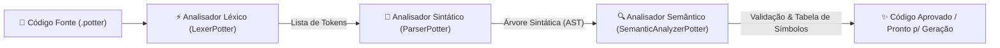

# 🪄 PotterLang: Compilador do Mundo Bruxo

Bem-vindo à documentação oficial do **PotterLang**, uma linguagem de programação temática inspirada no universo de Harry Potter, desenvolvida para a disciplina de **Compiladores**. 

O projeto implementa uma cadeia completa de compilação do código-fonte (front-end do compilador), abrangendo:
1. **Análise Léxica (Lexer)** com rastreamento de linhas e colunas;
2. **Análise Sintática (Parser LL(1) Recursivo Descendente)** com construção de Árvore de Sintaxe Abstrata (**AST**);
3. **Análise Semântica e Verificação de Tipos** com suporte a **Escopos Aninhados**, **Tabela de Símbolos** e comandos integrados para sistemas embarcados (**Arduino**).

---

## 📑 Sumário

- [1. Visão Geral da Arquitetura](#1-visão-geral-da-arquitetura)
- [2. Estrutura de Arquivos do Repositório](#2-estrutura-de-arquivos-do-repositório)
- [3. Especificação da Linguagem PotterLang](#3-especificação-da-linguagem-potterlang)
  - [3.1 Tipos de Dados](#31-tipos-de-dados)
  - [3.2 Palavras-Chave e Instruções](#32-palavras-chave-e-instruções)
  - [3.3 Operadores e Precedência](#33-operadores-e-precedência)
- [4. Explicação Detalhada do Código](#4-explicação-detalhada-do-código)
  - [4.1 Analisador Léxico (Lexer)](#41-analisador-léxico-lexer)
  - [4.2 Árvore de Sintaxe Abstrata (AST)](#42-árvore-de-sintaxe-abstrata-ast)
  - [4.3 Analisador Sintático (Parser LL(1))](#43-analisador-sintático-parser-ll1)
  - [4.4 Analisador Semântico e Tabela de Símbolos](#44-analisador-semântico-e-tabela-de-símbolos)
- [5. Scripts de Demonstração e Testes](#5-scripts-de-demonstração-e-testes)
  - [5.1 `exemplo_potter.py`](#51-exemplo_potterpy)
  - [5.2 `test_potter_lang.py`](#52-test_potter_langpy)
- [6. Como Executar o Projeto](#6-como-executar-o-projeto)
- [7. Exemplos de Código PotterLang](#7-exemplos-de-código-potterlang)

---

## 1. Visão Geral da Arquitetura

O compilador processa o código PotterLang através do seguinte pipeline sequencial:



1. **Entrada de Texto**: O código-fonte em PotterLang é fornecido como string.
2. **Tokenização**: O `LexerPotter` converte o fluxo de caracteres em uma lista de objetos `Token` tipados, ignorando espaços em branco e comentários (`--`).
3. **Parsing**: O `ParserPotter` consome os tokens segundo uma gramática livre de contexto LL(1) por descida recursiva, gerando nós da `ASTNode`.
4. **Análise Semântica**: O `SemanticAnalyzerPotter` percorre a AST via padrão *Visitor*, valida declarações, gerencia escopos (`Scope`), verifica imutabilidade de constantes (`VOTO`), checa tipos de operandos e previne chamadas inválidas.

---

## 2. Estrutura de Arquivos do Repositório

```text
compiladores-main/
│
├── potter_lang.py        # O núcleo do compilador (Lexer, AST, Parser, Semântico)
├── exemplo_potter.py     # Demonstração completa ponta a ponta e testes de erro
├── test_potter_lang.py   # Suíte de testes unitários automatizados (unittest)
└── README.md             # Esta documentação detalhada
```

| Arquivo | Função Principal |
| :--- | :--- |
| `potter_lang.py` | Implementa as 4 fases essenciais: `LexerPotter`, classes de nós `ASTNode`, `ParserPotter` e `SemanticAnalyzerPotter`. |
| `exemplo_potter.py` | Executa um programa de exemplo em PotterLang, exibindo a tabela de tokens, a árvore visual da AST, a tabela de símbolos e disparando baterias de validação contra erros semânticos. |
| `test_potter_lang.py` | Suíte de testes unitários automatizados cobrindo exaustivamente o analisador léxico, sintático e semântico. |

---

## 3. Especificação da Linguagem PotterLang

### 3.1 Tipos de Dados

| Tipo no PotterLang | Equivalente C / Python | Descrição Mágica | Exemplo de Valor |
| :--- | :--- | :--- | :--- |
| `GALLEON` | `int` | Moeda de ouro: números inteiros | `100`, `-42` |
| `SICKLE` | `float` | Moeda de prata: números decimais | `299792.458`, `3.14` |
| `PARCHMENT` | `char*` / `str` | Pergaminho: cadeias de caracteres | `"Expelliarmus!"` |
| `VERITAS` | `bool` | Verdade: valor booleano | `ALWAYS` (true), `NEVER` (false) |

### 3.2 Palavras-Chave e Instruções

| Palavra-Chave | Equivalente | Descrição |
| :--- | :--- | :--- |
| `HOGWARTS <Nome> { ... }` | `main` / `program` | Bloco principal que delimita o programa. |
| `VARINHA <Tipo> <id> ~> <expr>;` | Declaração de Variável | Declara uma variável mutável com tipo estático. |
| `VOTO <Tipo> <id> ~> <expr>;` | Declaração de Constante | Declara um "Voto Inquebrável", constante que não pode ser reatribuída. |
| `<id> ~> <expr>;` | Atribuição | Aceno de varinha (`~>`), usado para atribuir novo valor a variáveis. |
| `LUMOS(<expr>);` | `print()` / `printf()` | Projeta luz e imprime o valor da expressão no console. |
| `SORTILEGIO (<cond>) { ... }` | `if (<cond>) { ... }` | Estrutura condicional (ramo verdadeiro). |
| `SENAO { ... }` | `else { ... }` | Ramo alternativo da condicional. |
| `VIRATEMPO (<cond>) { ... }` | `while (<cond>) { ... }` | Laço de repetição temporal. |
| `INCANTATIO <nome>(<params>)` | Declaração de Função | Define um feitiço reutilizável com escopo próprio. |
| `CAST <nome>(<args>);` | Chamada de Função | Lança o feitiço ou executa comando de hardware. |
| `EXPELLIARMUS <expr>;` | `return <expr>;` | Finaliza a execução do feitiço e retorna um valor. |
| `-- comentário` | Comentário de Linha | Todo texto após `--` até o fim da linha é ignorado. |

### 3.3 Operadores e Precedência

A tabela a seguir apresenta os operadores suportados, ordenados da **menor** para a **maior** precedência:

| Nível de Precedência | Categoria | Operadores | Associatividade |
| :--- | :--- | :--- | :--- |
| 1 (mais baixa) | Lógico OU | `\|\|` | Esquerda |
| 2 | Lógico E | `&&` | Esquerda |
| 3 | Igualdade | `==`, `!=` | Esquerda |
| 4 | Relacional | `<`, `>`, `<=`, `>=` | Esquerda |
| 5 | Aditivo | `+`, `-` | Esquerda |
| 6 | Multiplicativo | `*`, `/`, `%` | Esquerda |
| 7 | Unário | `!`, `-`, `+` | Direita |
| 8 (mais alta) | Primário | Literais, Identificadores, `(...)` | - |

---

## 4. Explicação Detalhada do Código

O arquivo `potter_lang.py` é dividido em 4 módulos bem definidos:

### 4.1 Analisador Léxico (Lexer)

Localizado nas linhas 1 a 280 de `potter_lang.py`.

#### A. Enum `TokenType`
Define todos os tipos de símbolos atômicos reconhecidos pelo compilador:
- Palavras-chave do mundo bruxo: `HOGWARTS`, `VARINHA`, `VOTO`, `SORTILEGIO`, `SENAO`, `VIRATEMPO`, `LUMOS`, `INCANTATIO`, `CAST`, `EXPELLIARMUS`.
- Tipos de dados: `TYPE_GALLEON`, `TYPE_SICKLE`, `TYPE_PARCHMENT`, `TYPE_VERITAS`.
- Literais: `INT_LITERAL`, `FLOAT_LITERAL`, `STRING_LITERAL`, `ALWAYS`, `NEVER`.
- Operadores e delimitadores: `WAND_ASSIGN` (`~>`), aritméticos (`+`, `-`, `*`, `/`, `%`), lógicos (`&&`, `||`, `!`), relacionais (`==`, `!=`, `<`, `>`, `<=`, `>=`), delimitadores (`(`, `)`, `{`, `}`, `,`, `;`) e `EOF`.

#### B. Classe `Token`
```python
class Token:
    def __init__(self, type_: TokenType, value: Any, line: int, column: int):
        self.type = type_
        self.value = value
        self.line = line
        self.column = column
```
Armazena a categoria do token, seu valor textual/numérico convertido e sua posição exata (`line`, `column`) no arquivo-fonte, permitindo mensagens de erro cirúrgicas.

#### C. Classe `LexerPotter`
Responsável pela varredura (`tokenize()`):
- **`self.pos`**, **`self.line`**, **`self.col`**: Ponteiros do cursor de varredura.
- **`advance(step)`** e **`peek(offset)`**: Navegam pelo texto sem consumir tokens precipitadamente (lookahead de 1 caractere).
- **Descarte de Comentários**: Ao encontrar `--`, consome caracteres até a quebra de linha `\n`.
- **Atribuição Mágica**: Identifica `~>` e impede o operador de igualdade simples isolado `=` (lança erro didático: `"Atribuição simples inválida; use '~>'"`).
- **Tratamento de Strings**: Lê tudo entre aspas duplas `"` e reporta erro caso haja terminação prematura antes de fechar aspas.
- **Tratamento de Números**: Diferencia números inteiros (`GALLEON`) de decimais (`SICKLE`), acusando erro léxico se houver múltiplos pontos decimais (ex: `1.2.3`).
- **Identificadores e Tabela de Palavras-Chave**: Coleta sequências alfanuméricas (iniciadas por letra ou `_`) e consulta `self.keywords`. Se não for reservada, é catalogada como `IDENTIFIER`.

---

### 4.2 Árvore de Sintaxe Abstrata (AST)

Localizada nas linhas 283 a 497 de `potter_lang.py`.

Cada construção sintática da linguagem possui uma classe correspondente que herda de `ASTNode`:

```mermaid
classDiagram
    class ASTNode {
        +int line
        +print_tree(indent, is_last) str
    }
    class ProgramNode {
        +str name
        +List~ASTNode~ body
    }
    class VarDeclNode {
        +bool is_const
        +str data_type
        +str name
        +ASTNode value_expr
    }
    class AssignNode {
        +str name
        +ASTNode expr
    }
    class LumosNode {
        +ASTNode expr
    }
    class SortilegioNode {
        +ASTNode condition
        +List~ASTNode~ then_branch
        +List~ASTNode~ else_branch
    }
    class ViraTempoNode {
        +ASTNode condition
        +List~ASTNode~ body
    }
    class FuncDeclNode {
        +str name
        +List~str~ params
        +List~ASTNode~ body
    }
    class CallNode {
        +str name
        +List~ASTNode~ args
    }
    class ExpelliarmusNode {
        +ASTNode expr
    }
    class BinaryOpNode {
        +ASTNode left
        +str op
        +ASTNode right
    }
    class UnaryOpNode {
        +str op
        +ASTNode operand
    }
    class LiteralNode {
        +Any value
        +str type_name
    }
    class IdentifierNode {
        +str name
    }

    ASTNode <|-- ProgramNode
    ASTNode <|-- VarDeclNode
    ASTNode <|-- AssignNode
    ASTNode <|-- LumosNode
    ASTNode <|-- SortilegioNode
    ASTNode <|-- ViraTempoNode
    ASTNode <|-- FuncDeclNode
    ASTNode <|-- CallNode
    ASTNode <|-- ExpelliarmusNode
    ASTNode <|-- BinaryOpNode
    ASTNode <|-- UnaryOpNode
    ASTNode <|-- LiteralNode
    ASTNode <|-- IdentifierNode
```



- **Visualização Gráfica (`print_tree`)**: Todos os nós implementam renderização hierárquica usando caracteres Unicode (`├──`, `└──`, `│   `) e emojis temáticos, permitindo inspecionar a AST de forma clara no terminal.

---

### 4.3 Analisador Sintático (Parser LL(1))

Localizado nas linhas 498 a 757 de `potter_lang.py`.

A classe `ParserPotter` consome o fluxo de tokens gerado pelo Lexer utilizando **Análise Preditiva por Descida Recursiva**:

#### Métodos de Controle do Cursor
- **`peek()`**: Retorna o token atual sob o cursor sem consumi-lo.
- **`previous()`**: Retorna o último token consumido.
- **`check(type_)`**: Checa se o token atual é do tipo esperado.
- **`match(*types)`**: Consome e retorna `True` se o token atual bater com algum dos tipos listados.
- **`consume(type_, message)`**: Consome obrigatoriamente o tipo especificado ou dispara `SyntaxError` com mensagem explicativa e coordenadas de linha/coluna.

#### Gramática de Declarações e Comandos (`statement()`)
1. **`parse()`**: Exige início com `HOGWARTS <IDENTIFICADOR> {`, lê os comandos do corpo até encontrar `}` e garante que o arquivo terminou consumindo `EOF`.
2. **`var_declaration()`**: Processa declarações `VARINHA` (mutável) ou `VOTO` (constante), validando o tipo bruxo (`GALLEON`, `SICKLE`, `PARCHMENT`, `VERITAS`), o nome, o operador `~>`, a expressão de inicialização e o ponto e vírgula `;`.
3. **`assignment_statement()`**: Processa reatribuições `<identificador> ~> <expressão>;`.
4. **`lumos_statement()`**: Processa o comando de impressão `LUMOS(<expressão>);`.
5. **`sortilegio_statement()`**: Processa `SORTILEGIO (<cond>) { ... }` com bloco opcional `SENAO { ... }`.
6. **`viratempo_statement()`**: Processa o laço `VIRATEMPO (<cond>) { ... }`.
7. **`incantatio_statement()`**: Processa a assinatura do feitiço, sua lista de parâmetros separados por vírgula e o corpo de instruções entre chaves.
8. **`cast_statement()`**: Processa a invocação `CAST <nome>(<argumentos>);`.
9. **`expelliarmus_statement()`**: Processa o retorno `EXPELLIARMUS <expressão>;`.

#### Cadeia de Precedência de Expressões
A precedência matemática e lógica é estruturada em cascata de métodos. Cada método chama o nível imediatamente superior:

```
expression() 
  └── logical_or()      (||)
        └── logical_and()    (&&)
              └── equality()      (==, !=)
                    └── relational()    (<, >, <=, >=)
                          └── additive()      (+, -)
                                └── multiplicative() (*, /, %)
                                      └── unary()          (!, -, +)
                                            └── primary()        (literais, IDs, (expr))
```

---

### 4.4 Analisador Semântico e Tabela de Símbolos

Localizado nas linhas 758 a 989 de `potter_lang.py`.

#### A. Classe `Symbol`
Representa um registro na Tabela de Símbolos:
- `name`: Nome do identificador.
- `tipo`: Tipo de dado associado (`GALLEON`, `SICKLE`, `PARCHMENT`, `VERITAS` ou `None` para feitiços).
- `categoria`: `"VARINHA"` (variável), `"VOTO"` (constante) ou `"INCANTATIO"` (feitiço).
- `line`: Linha onde foi declarado.
- `params`: Lista de parâmetros formais (se for feitiço).

#### B. Classe `Scope` (Escopo Estático/Léxico)
Implementa a árvore de escopos:
- Possui um dicionário local `self.symbols`.
- Mantém referência ao escopo pai (`self.parent`).
- **`declare(symbol)`**: Registra o símbolo no escopo atual. Dispara `SemanticError` se o identificador já existir **no mesmo escopo** (impede redeclaração no mesmo bloco).
- **`resolve(name)`**: Busca o símbolo localmente; se não encontrar, sobe recursivamente para o escopo pai (`parent`) até atingir o escopo global.

#### C. Classe `SemanticAnalyzerPotter`
Implementa o padrão **Visitor** percorrendo todos os nós da AST:

1. **`visit_VarDeclNode`**:
   - Infere o tipo da expressão atribuída (`infer_type`).
   - Verifica se o tipo da expressão é compatível com o tipo declarado na variável.
   - Cadastra o símbolo no escopo corrente (`VARINHA` ou `VOTO`).
2. **`visit_AssignNode`**:
   - Resolve o símbolo. Se não existir, acusa erro de variável não declarada.
   - Se for um `VOTO`, proíbe alteração ("Voto Inquebrável não pode ser alterado").
   - Se for `INCANTATIO`, proíbe atribuição a feitiço.
   - Valida compatibilidade do novo tipo de dado com o tipo original da variável.
3. **`visit_SortilegioNode` & `visit_ViraTempoNode`**:
   - Exigem estritamente que a expressão condicional seja avaliada como `VERITAS` (booleano).
   - Abrem novos escopos aninhados (`visit_bloco`) para o corpo das estruturas.
4. **`visit_FuncDeclNode`**:
   - Registra o feitiço no escopo onde foi declarado.
   - Cria um novo escopo filho específico para o feitiço (`INCANTATIO <nome>`).
   - Registra os parâmetros formais dentro do escopo do feitiço.
   - Ativa a flag `self.dentro_de_incantatio = True` para permitir comandos de retorno.
5. **`visit_ExpelliarmusNode`**:
   - Valida se o comando está sendo conjurado exclusivamente dentro de uma função (`dentro_de_incantatio == True`). Caso contrário, emite erro semântico.
6. **`visit_CallNode`**:
   - Verifica se a função existe ou se é um comando embutido de **Arduino** (`ARDUINO_BUILTINS`: `pinMode`, `digitalWrite`, `digitalRead`, `analogWrite`, `analogRead`, `delay`).
   - Valida a **aridade** (número exato de argumentos passados versus número de parâmetros esperados).
7. **Inferência Estática de Tipos (`infer_type`)**:
   - Operadores de comparação (`<`, `>`, `<=`, `>=`) exigem tipos numéricos e retornam `VERITAS`.
   - Operadores lógicos (`&&`, `||`, `!`) exigem operandos `VERITAS` e retornam `VERITAS`.
   - Operadores aritméticos (`+`, `-`, `*`, `/`, `%`) exigem operandos numéricos; se envolver `SICKLE` (float), o resultado é promovido a `SICKLE`; caso contrário, `GALLEON` (int).

---

## 5. Scripts de Demonstração e Testes

### 5.1 `exemplo_potter.py`

Este script atua como demonstrador visual de todas as etapas:
1. Define um programa PotterLang completo (`HOGWARTS Grifinoria`);
2. **Executa o Lexer** e imprime a lista de tokens reconhecidos com suas posições;
3. **Executa o Parser** e imprime a árvore sintática (`AST`) estilizada;
4. **Executa o Analisador Semântico** e imprime a Tabela de Símbolos completa;
5. **Executa a Bateria de Testes Negativos**: Submete 6 códigos contendo erros propositais para comprovar que o compilador os detecta e rejeita corretamente:
   - *Reatribuir VOTO (constante)*;
   - *Variável não declarada*;
   - *Incompatibilidade de Tipo*;
   - *Redeclaração no mesmo escopo*;
   - *Condição não booleana no SORTILEGIO*;
   - *EXPELLIARMUS fora de INCANTATIO*.

### 5.2 `test_potter_lang.py`

Suíte de testes de unidade automatizada em Python (`unittest`):
- **`LexerTests`**:
  - `test_all_literals_keywords_delimiters_and_operators`: Valida a tokenização de todos os operadores, tipos e pontuações da linguagem;
  - `test_comments_are_ignored_and_columns_continue`: Garante descarte correto de comentários `--`;
  - `test_numbers_and_identifiers`: Testa números inteiros e ponto flutuante;
  - `test_lexical_errors`: Testa rejeição de caracteres inválidos (`@`, `=`, `&`, strings sem fechar, etc.).
- **`ParserTests`**:
  - `test_expression_precedence_and_unary_nodes`: Testa se `!`, `<` e `||` formam a hierarquia correta na AST;
  - `test_parser_rejects_trailing_tokens`: Rejeita lixo sintático após o fechamento do bloco principal;
  - `test_parser_rejects_missing_statement_terminator`: Exige o término com `;`.
- **`SemanticTests`**:
  - Testa programas válidos com lógica, laços e comandos Arduino;
  - Testa rejeição de reatribuição de constantes;
  - Testa identificadores desconhecidos e redeclarações;
  - Testa validação estrita de condições booleanas e operadores aritméticos;
  - Testa aridade incorreta em funções de usuário e no Arduino;
  - Testa retorno `EXPELLIARMUS` fora de função.

---

## 6. Como Executar o Projeto

### Pré-requisitos
- **Python 3.8** ou superior instalado e configurado no PATH do sistema.

### Executar o Exemplo Interativo
No terminal, dentro da pasta do projeto, execute:
```bash
python exemplo_potter.py
```
Você verá:
- A listagem de tokens gerada pelo Lexer;
- A árvore sintática AST detalhada;
- A confirmação da análise semântica e a Tabela de Símbolos formatada;
- Os resultados da captura de erros sintáticos e semânticos.

### Executar a Suíte de Testes Unitários
Para rodar todos os testes automatizados com relatório detalhado:
```bash
python -m unittest -v test_potter_lang.py
```

---

## 7. Exemplos de Código PotterLang

### Olá Hogwarts e Condicional Simples
```potter
HOGWARTS SelecaoCasas {
    VARINHA PARCHMENT mensagem ~> "O Chapeu Seletor esta decidindo...";
    LUMOS(mensagem);

    VARINHA GALLEON coragem ~> 95;
    SORTILEGIO (coragem >= 80) {
        LUMOS("Bem-vindo a Grifinoria!");
    } SENAO {
        LUMOS("Destinado a Lufa-Lufa!");
    }
}
```

### Laço Vira-Tempo e Constante Inquebrável
```potter
HOGWARTS SalaPrecisa {
    VOTO GALLEON LIMITE_VOLTAS ~> 3;
    VARINHA GALLEON voltaAtual ~> 0;

    VIRATEMPO (voltaAtual < LIMITE_VOLTAS) {
        voltaAtual ~> voltaAtual + 1;
        LUMOS("Voltando no tempo, ciclo:");
        LUMOS(voltaAtual);
    }
}
```

### Feitiço com Retorno e Integração Arduino
```potter
HOGWARTS LaboratorioMagico {
    VARINHA GALLEON pinoLed ~> 13;
    VARINHA VERITAS estadoLed ~> ALWAYS;

    -- Configuração do pino digital no Arduino
    CAST pinMode(pinoLed, 1);

    INCANTATIO piscarLuz(pino, duracao) {
        CAST digitalWrite(pino, ALWAYS);
        CAST delay(duracao);
        CAST digitalWrite(pino, NEVER);
        CAST delay(duracao);
        EXPELLIARMUS ALWAYS;
    }

    -- Invocação do feitiço
    CAST piscarLuz(pinoLed, 500);
}
```
